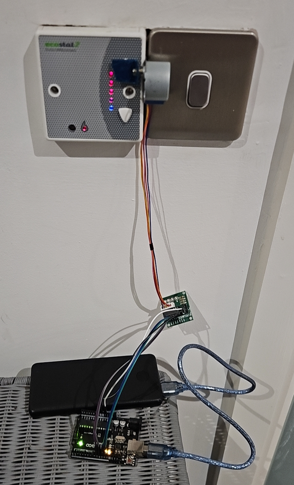
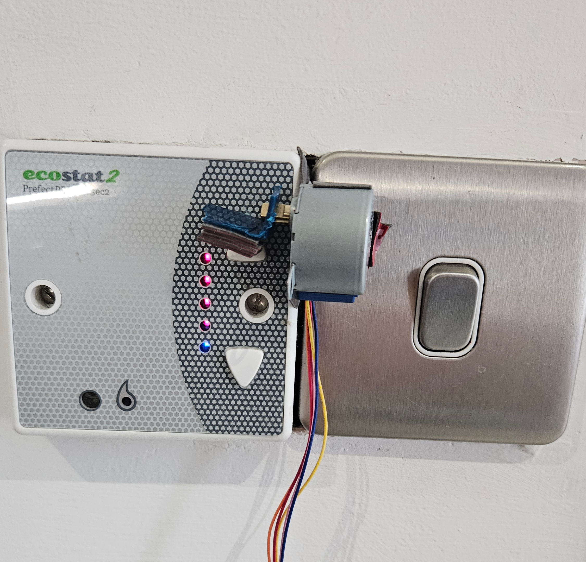
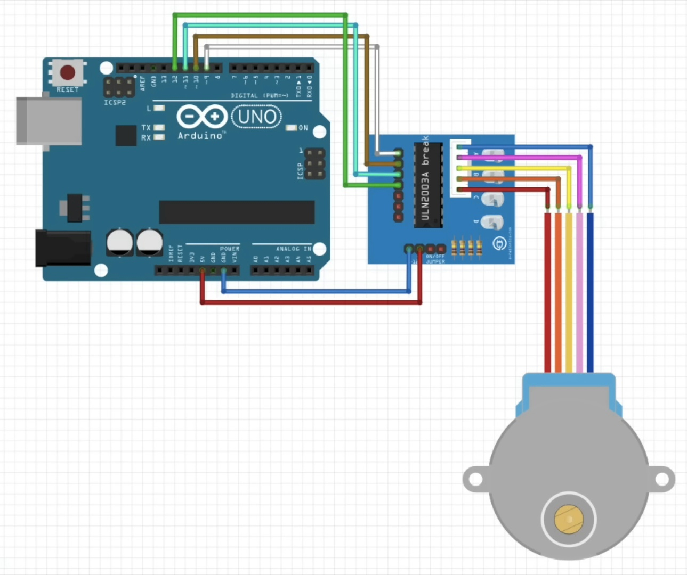

# button-presser

> A small Arduino-powered "robot finger" that keeps a timer-based thermostat switched on by pressing its heat button automatically. Built for about **£30** instead of buying a plug-in heater.



---

## Table of Contents

1. [The Problem](#the-problem)
2. [The Solution](#the-solution)
3. [Will This Work for You?](#will-this-work-for-you)
4. [How It Works](#how-it-works)
5. [Parts List and Costs](#parts-list-and-costs)
6. [Tools and Software](#tools-and-software)
7. [Wiring](#wiring)
8. [Build Guide](#build-guide)
9. [The Code](#the-code)
10. [Calibration](#calibration)
11. [Power](#power)
12. [Results](#results)
13. [Troubleshooting](#troubleshooting)
14. [Lessons Learned and Limitations](#lessons-learned-and-limitations)
15. [Better Approaches and Possible Improvements](#better-approaches-and-possible-improvements)
16. [Is It Worth It? Cost Comparison](#is-it-worth-it-cost-comparison)
17. [Safety and Practical Notes](#safety-and-practical-notes)
18. [Repository Structure](#repository-structure)
19. [Credits](#credits)
20. [License](#license)

---

## The Problem

I lived in a student studio flat where the heating was controlled by a wall thermostat that worked on a **timer**.

- The thermostat had **two buttons**: one to turn the heat up, one to turn it down.
- There were **five heat settings** (1 = coldest, 5 = hottest).
- Pressing the up button 5 times turned the heating on at the hottest setting.
- The catch: after **only 20 minutes the heating switched itself off**, and the whole process had to be repeated.
To keep the flat warm you would have to press the button around **50 times a day**. In practice, I was waking up in the middle of the night, freezing cold even with warm clothes on, and walking over to the thermostat to turn the heating back on.

Many students solve this by buying a plug-in heater or radiator. I found that wasteful and unnecessary, so I built something to do the button pressing for me.

**My thermostat:** Prefect Ecostat2, with five LEDs showing the heat setting.
 

## The Solution

A small Arduino-controlled motor is stuck next to the thermostat. At a regular interval it turns, a small plastic "finger" presses the heat-up button, and it returns to its resting position. The thermostat never gets the chance to time out, so the heating stays on.

It is deliberately **simple and cheap**: no soldering, no 3D printing, no custom electronics. Everything was bought from Amazon, plugged together with jumper wires, and held in place with double-sided tape.
 

 
 
## Will This Work for You?

This project only suits thermostats that have **physical, mechanical buttons** that can be pressed by a small motor.

| Works well | Will not work |
|------------|---------------|
| Thermostats with a push button (like mine) | Touchscreen or capacitive touch thermostats |
| Buttons that are easy to reach and have a clear click | Buttons that are recessed deep inside the casing |
| Buttons that need only light pressure | Buttons that need a very firm press |

It is also aimed at a fairly specific problem: a thermostat that **times out** and needs pressing again and again. If your thermostat has a proper programmable schedule, use that instead.
 

## How It Works

```
 Power bank ──USB──▶ Arduino board ──wires──▶ ULN2003 driver board ──▶ 28BYJ-48 stepper motor
                                                                                  │
                                                                      bottle-cap "finger" presses
                                                                     the thermostat's heat button
```

1. The **Arduino** runs a short program. It presses the button once as soon as it powers on, then again every **60 seconds**.
2. Each press tells the **ULN2003 driver board** to turn the **28BYJ-48 motor** **435 steps** forward, with a 2 ms pause between steps.
3. A small piece of **plastic cut from a bottle cap** is attached to the motor shaft. As the motor turns, it presses the thermostat button.
4. The motor holds for **200 ms**, then steps back the same 435 steps to its resting position.
5. The motor coils are **switched off** between presses so the motor does not overheat and the battery lasts longer.

The ULN2003 board is needed because the Arduino pins cannot supply enough current to drive the motor directly.
 

## Parts List and Costs

All parts were bought from Amazon UK. Several were sold in multi-packs, so I have spares for future projects. Only **one** of each part is actually needed for this build.

| # | Part | What it does | Qty needed | Qty bought | Cost (£) | Link |
|---|------|--------------|:---------:|:----------:|---------:|------|
| 1 | Elegoo UNO R3 board (Arduino-compatible) | The "brain" that runs the code | 1 | 1 | 12.10 | [Amazon](https://amzn.eu/d/01Tw4LBA) |
| 2 | JZK 5V geared stepper motors (28BYJ-48), 4-pack, **including 4 ULN2003 driver boards** | Turns to press the button | 1 + 1 driver | 4 + 4 | 9.99 | [Amazon](https://amzn.eu/d/02aqiKWH) |
| 3 | Elegoo 120-piece jumper wire kit (male-to-male, female-to-female, male-to-female) | Connects everything together | a handful | 120 | 5.63 | [Amazon](https://amzn.eu/d/0hyNNKsh) |
| 4 | 3M double-sided tape | Mounts the motor to the thermostat | 1 roll | 1 | ~2.50 | [Amazon](https://amzn.eu/d/05dkqlPs) |
| 5 | Plastic piece cut from a bottle cap | The "finger" that presses the button | 1 | 1 | Free | n/a |
| | | | | **Total** | **£30.22** | |

**Optional / not included in the total:**

| Part                                                                    | Notes                                                                                                                                                                                             | Cost (£)        |
| ----------------------------------------------------------------------- | ------------------------------------------------------------------------------------------------------------------------------------------------------------------------------------------------- | --------------: |
| USB power bank (mine was an **Anker PowerCore Slim 10000**, 10,000 mAh) | Powers the project when no wall socket is near. Most are under £20 on Amazon. You could also use a PC USB port, a USB wall adapter, or a PSU instead. See [Power](#power) for an important catch. | Already owned   |
| USB cable (A to B)                                                      | Needed to program the board and to power it                                                                                                                                                       | Came with board |

> **Note:** The 28BYJ-48 motors are very cheap individually, but sellers rarely list them one at a time because shipping would cost more than the part. A multi-pack is usually the most sensible option.

A copy of this table is in [`docs/costs.csv`](docs/costs.csv).

*Prices are what I paid at the time of purchase (January 2026) and will vary.*
 

### Alternatives

- **Board:** Any Arduino UNO or compatible clone will work.
- **Motor and driver:** The 28BYJ-48 + ULN2003 pair is very common and usually sold together. But see [Better Approaches](#better-approaches-and-possible-improvements): a small servo may be an easier choice.
- **Wires:** Any basic jumper wires will do. You only need a handful.

## Tools and Software

| Item | Purpose |
|------|---------|
| A computer (Windows / macOS / Linux) | To write, test and upload the code |
| [Arduino IDE](https://www.arduino.cc/en/software) | Software used to program the board |
| USB cable (A to B) | Connects the Arduino to the computer |
| Scissors or a craft knife | To cut the plastic piece from the bottle cap |
 

## Wiring



The wiring diagram I followed came from the YouTube channel **[@NikoDembartnik](https://www.youtube.com/@NikoDembartnik)**. His video also has some very useful information about this motor, and I recommend watching it: **[28BYJ-48 stepper motor and ULN2003 Arduino (Quick tutorial for beginners)](https://www.youtube.com/watch?v=avrdDZD7qEQ)**. Full credit to him for the diagram.
 

### Connection table

Based on the diagram I followed. These pins match the sketch: `STEPPER_PIN_1` to `STEPPER_PIN_4` in [`code/button-presser.ino`](code/button-presser.ino).

| ULN2003 driver pin | Arduino pin | Name in the sketch |
|--------------------|-------------|--------------------|
| IN1 | 9 | `STEPPER_PIN_1` |
| IN2 | 10 | `STEPPER_PIN_2` |
| IN3 | 11 | `STEPPER_PIN_3` |
| IN4 | 12 | `STEPPER_PIN_4` |
| `+` (power) | 5V | — |
| `-` (power) | GND | — |

The motor's white plug goes straight into the socket on the ULN2003 driver board.
 

## Build Guide

### Step 1: Gather your parts

Lay everything out and check you have the board, one motor, one ULN2003 driver, jumper wires, a USB cable, a power source, and double-sided tape.
 

### Step 2: Set up the Arduino IDE

1. Download and install the [Arduino IDE](https://www.arduino.cc/en/software).
2. Plug the Arduino into your computer with the USB cable.
3. In the IDE, select your board under **Tools → Board** and the correct port under **Tools → Port**.

### Step 3: Connect the motor

Wire the ULN2003 board to the Arduino using the [connection table](#connection-table) above, then plug the motor into the driver board.
 

### Step 4: Make the button "finger"

1. Cut a small piece of plastic from a bottle cap and shape it into a **right-angle piece**.
2. Make a **hole** in it that fits snugly over the motor shaft.
3. Push it onto the shaft. It should be tight enough to stay on by **friction alone** (no glue needed). Adjust the hole size if it slips.

### Step 5: Upload the code

Open the sketch from the [`code/`](code/) folder in the Arduino IDE and upload it to the board. See [The Code](#the-code).
 

### Step 6: Test on the desk first

Before mounting anything, power everything up and watch the motor. Confirm that it turns, presses down, holds briefly, and returns as expected.
 

### Step 7: Mount on the thermostat

1. Clean and dry the surface around the thermostat.
2. Use **plenty** of 3M double-sided tape so the motor cannot shift. Even a small movement will make it miss the button.
3. Position the motor so the plastic finger lines up exactly with the **heat-up button**.
4. The ULN2003 board and wires can be kept neat nearby (in my build the driver board was taped to the wall below the thermostat).

### Step 8: Calibrate

See [Calibration](#calibration) below. This is the most important (and fiddliest) step.
 

### Step 9: Power it

Connect the Arduino to your power source and leave it running. **Read [Power](#power) first** if you are using a power bank.
 

## The Code

The sketch is [`code/button-presser.ino`](code/button-presser.ino). It does not use the Arduino `Stepper` library. It drives the motor directly by writing the four coil pins.

In plain terms, the program:

1. In `setup()`, sets pins 9–12 as outputs and calls `runMotorSequence()` once, so the first press happens as soon as the board powers on.
2. In `loop()`, waits `interval` (**60000 ms**, one minute), then calls `runMotorSequence()` again. That repeats forever.
3. `runMotorSequence()` steps forward `steps_per_activation` times (**435**), pausing **2 ms** after each step.
4. It then waits `activation_action_pause` (**200 ms**) while the finger is on the button.
5. It steps back the same 435 steps, again with a 2 ms pause between steps, so the finger returns to its resting position.
6. It sets all four coil pins `LOW` so the motor is not left energised.

`stepMotor()` is a four-phase **wave-drive** sequence: only one coil is high at a time. Forward motion walks pin 9 → 10 → 11 → 12. Reverse motion walks that order backwards. That is the same step size as the usual full-step count for this motor (about **2048 steps per revolution**), not the 8-step half-step pattern (about 4096). One coil at a time has less torque than energising two coils together, which is fine here because the button only needs a light press.

Each press therefore takes about **435 × 2 ms** each way, plus the 200 ms hold: roughly **2 seconds** of motion, then a 60 second wait.

### Settings you may want to change

| Setting | Variable in the sketch | What it does | Value in this build |
|---------|------------------------|--------------|---------------------|
| Steps per press | `steps_per_activation` | How far the motor turns to reach the button, and how far it turns back | `435` |
| Interval | `interval` | Time between presses, after the first press on startup | `60000` ms (60 seconds) |
| Hold time | `activation_action_pause` | How long the finger stays on the button | `200` ms |
| Step delay | `delay(2)` inside `runMotorSequence()` | Pause between steps. A smaller number is faster. | `2` ms |

The 2 ms step delay is about as fast as a 28BYJ-48 should be driven. This motor tops out around 15 RPM at the output shaft, which works out to roughly one step every 2 ms if you count 2048 steps per revolution. If the motor buzzes instead of turning, increase that delay first. See [Troubleshooting](#troubleshooting).

### Why release the coils?

A stepper motor draws current whenever its coils are energised, even when it is standing still. Leaving them on after each press makes the motor **hot** and drains the battery. I ran into overheating at one point, so the code switches all four coil pins off after every press.
 

## Calibration

Every thermostat is different, so you will need to find the right number of motor steps for yours.

1. Start with a **small** step count in the code.
2. Upload and watch whether the finger reaches the button.
3. Increase the steps **gradually** until the button clicks reliably.
4. Make sure the finger returns fully so the button can pop back up.
5. Once it works, leave it alone. It should run without much interference.

> **Warning:** Do not overshoot. If the motor tries to turn further than the button (or the mounting) allows, it can strain the motor's internal plastic gears and damage it. Always increase in small increments. See [Lessons Learned](#lessons-learned-and-limitations).

> **Tip:** The 28BYJ-48 has a built-in gearbox, so it takes many steps to make one full turn (commonly 2048 steps per revolution in full-step or wave-drive mode, or 4096 in half-step mode). Only a small fraction of a turn is needed here.

The sketch in this repository is already set to the value that worked on my Prefect Ecostat2: **435** steps (`steps_per_activation`). Against 2048 steps per revolution, that is about a **76°** turn of the output shaft: enough for the bottle-cap finger to click the heat-up button, and still come back clear of it.
 

## Power

- The Arduino and motor were powered by an **Anker PowerCore Slim 10000** (10,000 mAh).
- It ran for about **3 days** before needing a recharge.

### The power bank catch

Most power banks are designed to charge phones, so they **switch themselves off when the current draw is too low**. An idle Arduino draws very little, so the power bank decides nothing useful is connected and cuts power. This is a well-known issue, with the shut-off threshold often quoted at somewhere around 50 to 200 mA, and some shut off after as little as 30 seconds.

I believe this is why I had to run the motor **about once a minute**: with longer gaps, the power bank would switch off and the whole system would stop. Pressing frequently kept the draw high enough often enough to stay awake. (I have not measured this, so treat it as my best explanation.)

If you want to avoid the problem, you could:

- **Use a wall USB adapter or a PC/PSU USB port instead.** This is the simplest fix and removes the battery life limit entirely.
- **Use a power bank with an "always on" or "low current" mode.** Check the manual. Many have it, usually activated by a double-press or long-press of the button.
- **Add a "keep-alive" load.** Examples include an LED with a resistor, or a small pulsing circuit that periodically draws a short burst of current. These work but add extra parts and use extra power.

## Results


- The heating stayed on without me having to touch the thermostat.
- No more night-time trips to the thermostat.
- Worked reliably once calibrated and firmly mounted.

## Troubleshooting

| Problem | Possible causes | What to try |
|---------|-----------------|-------------|
| **Motor buzzes or vibrates but does not turn** | The motor's internal gears are broken or damaged (this can happen if it was forced or over-rotated) | Try a spare motor. If the spare works, the first one is damaged. |
| | The code is not set up correctly, such as wrong pin numbers or the wrong coil order | Check the pin numbers match your wiring. In this sketch, forward motion is pin 9 → 10 → 11 → 12 (`stepMotor()`). |
| | The motor is being driven too fast | Increase the `delay(2)` between steps in `runMotorSequence()`. This motor is slow, with a maximum of roughly 15 RPM at the output shaft, and 2 ms is already near that limit. |
| | A wire or the motor plug is loose | Re-seat all jumper wires and make sure the white motor plug is fully pushed in. |
| **Nothing happens at all** | No power to the driver board | The ULN2003 board has LEDs that flash when it is receiving signals. If none light up, check the `+` and `-` wires to 5V and GND. |
| | Wrong board or port selected in the IDE | Check **Tools → Board** and **Tools → Port**. |
| | Arduino not detected by the computer | Try a different USB cable (some are charge-only) and check you have the right driver installed. |
| **Motor turns but the button does not click** | Not enough steps, or the finger is misaligned | Raise `steps_per_activation` a little (this build uses 435) and check the finger lines up with the button. |
| **Motor presses but the heating does not come on** | The finger is not pressing long or firmly enough | Increase `activation_action_pause` slightly (it is 200 ms in this build) or adjust the position. |
| **Motor gets hot** | Coils left energised after moving | Make sure the code switches all four coil pins off after each press. |
| **Works for a while, then everything stops** | Power bank auto-shut-off due to low current draw | See [The power bank catch](#the-power-bank-catch). |
| **It misses the button after a few days** | The tape has loosened or the motor has moved | Remount with fresh, generous double-sided tape and recalibrate. |
| **Motor shaft turns but the finger slips** | The hole in the finger is too loose | Make a new finger with a tighter hole. |
 

## Lessons Learned and Limitations

- **The 28BYJ-48 was probably not the best choice.** A stepper motor has no idea where the button actually is. It just counts steps, so I had to calibrate by trial and error, which was **time-consuming, fiddly and not always reliable**.
- **It can damage itself.** If the motor is told to turn too far, there is nothing to stop it, and the plastic gearing inside can be strained or broken. That makes calibration a bit risky.
- **The interval had to be short** (`interval` is 60 seconds) because of the power bank's auto-shut-off. See [Power](#power).
- **Mounting matters.** It must be firmly attached with plenty of tape or it will shift and miss the button.
- **No enclosure.** The motor and board are exposed. A case would be neater and more robust.
- **Battery life** was about 3 days per charge on a 10,000 mAh power bank.

## Better Approaches and Possible Improvements

I kept this build as cheap as possible, but here is what I would consider if starting again or if you want to improve on it.
 

### A better actuator than the 28BYJ-48

The ideal actuator for this job moves to a **known position**, applies **gentle, limited force**, and has a **forgiving failure mode**. Some options:

| Option | Why it could be better | Downsides |
|--------|------------------------|-----------|
| **Micro servo (e.g. SG90 or the metal-gear MG90S)** | Moves to a set angle, so you only need to choose a "rest" angle and a "press" angle instead of counting steps. Much easier to calibrate and repeatable. Very cheap, only 3 wires, and needs no driver board. Hobbyists commonly use small servos for button-pushing jobs such as camera triggers, and there are ready-made 3D-printable button-pusher brackets for SG90 servos. | Can still strain its gears or draw extra current if blocked, so choose angles carefully. Cheap SG90 servos have plastic gears. Can buzz when holding position, so it is best to detach the servo after each press. |
| **Push solenoid** | Short, fixed push with no calibration. Naturally "taps" the button. | Needs a transistor/MOSFET and a diode to drive it, draws more current, and the force and stroke are hard to tune. Needs a good mounting position directly in front of the button. |
| **Commercial button pusher (e.g. SwitchBot Bot)** | No building or coding at all. | More expensive, and defeats the point of the learning project. |
| **Wire a transistor or relay across the button contacts** | No moving parts at all. | Needs the thermostat to be opened up and modified. Not suitable for beginners, rented accommodation, or anything you are not allowed to change. |

My suggestion for a re-build would be an **SG90 or MG90S micro servo**: it is as cheap as the 28BYJ-48 set, has fewer wires and parts, and the "press angle" is far easier to tune than a step count. I have **not tested this myself**, so treat it as a suggestion to try rather than a proven result.
 

### Other improvements

- **A better power setup:** a USB wall adapter, or a power bank with an "always on" mode, would allow a longer interval and avoid the shut-off problem. See [Power](#power).
- **Real-time clock (RTC) module** (e.g. DS3231): keeps accurate time and would let the project only run at certain hours (for example overnight). It does not fix the power bank problem by itself.
- **A case or enclosure:** bought online or 3D printed, to hold the motor securely and neatly.
- **Sleep mode:** putting the Arduino to sleep between presses would cut power use (but would make the power bank shut-off problem worse if you are using one).
- **A mechanical stop** so that the finger physically cannot travel too far.

## Is It Worth It? Cost Comparison

| Option                    | Approx. cost | Notes                                                                              |
| ------------------------- | -----------: | ---------------------------------------------------------------------------------- |
| This project              | £30.22       | Small, reusable parts, very little space                                           |
| Plug-in heater / radiator | £75+         | Takes up space, uses extra electricity, probably not needed again after moving out |

Beyond cost, I ended up with leftover parts (3 more motors and drivers, plus lots of jumper wires) that I can reuse in future projects, and I learned how to work with Arduino boards and stepper motors. Space is also usually very limited in student accommodation, and this takes up almost none.
 

## Safety and Practical Notes

- If you rent, check that sticking things to the thermostat or wall is allowed, and test the tape on a small area first.
- Do **not** leave exposed electronics where they can be knocked, wet, or touched by children or pets.
- This project only **presses a button**. It does not modify the thermostat or the heating system itself.
- Keeping the heating on constantly will use more energy. Consider a sensible schedule.
- You build and use this at your own risk.

## Repository Structure

```
button-presser/
├── README.md
├── LICENSE
├── code/                 # Arduino sketch(es)
│   └── button-presser.ino
├── images/               # Photos of the finished build and each step
├── wiring/               # Wiring diagram (credit to @NikoDembartnik)
└── docs/
    └── costs.csv         # Parts list and costs
```

## Credits

- **Wiring diagram and motor information:** [@NikoDembartnik](https://www.youtube.com/@NikoDembartnik) on YouTube. [28BYJ-48 stepper motor and ULN2003 Arduino (Quick tutorial for beginners)](https://www.youtube.com/watch?v=avrdDZD7qEQ)
- Built by **[iAdam368](https://github.com/iAdam368)**.

---

*Found this useful or built your own version? Feel free to open an issue or pull request. I would love to see it.*
